# Pilot review
Thirty-five pictures from the second picture pilot, twelve person-fold decisions and five shapes to approve before the wide run. Each picture shows as the timeline would show it, with its caption and credit.
Keep leaves a picture on the page; Drop deletes the picture and its record. A fold decision's Keep applies it, Edit takes your correction, Drop leaves both ids. The shapes at the end set how the rest of the session runs.

## The pictures: well-attested batch 1 (16 of 25 stories) and told-once batch 1 (16 of 25)

### 1. Jacqu Cornon deathbed confession about Brown's 1956 Paris vacuum chamber test
well-attested, Paris, France. object, free.

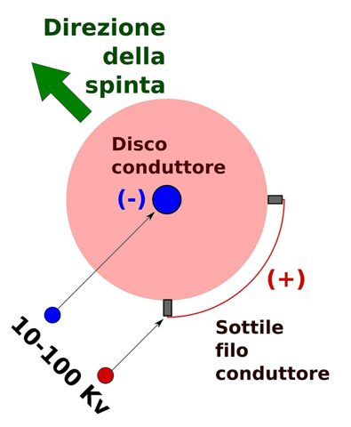

Recommended: Keep: it fits the story and the voice.

<!-- ask: single: Keep | Drop -->

### 2. OSAP at Skinwalker Ranch and the hitchhiker effect
well-attested, Skinwalker Ranch, Utah. place-now, free.

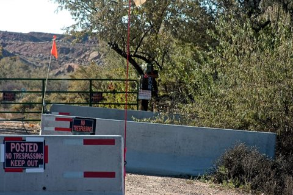

Recommended: Keep: it fits the story and the voice.

<!-- ask: single: Keep | Drop -->

### 3. Caretaker Tom Lewis collapses during drilling as the 1.6 GHz signal appears
well-attested, Below the mesa, Skinwalker Ranch. place-now, free.

Recommended: Keep: it fits the story and the voice.

<!-- ask: single: Keep | Drop -->

### 4. Talbert newspaper series on 1950s aerospace anti-gravity interest
well-attested, United States. object, free.

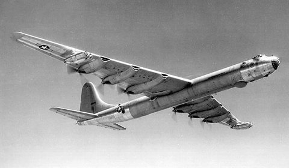

Recommended: Keep: it fits the story and the voice.

<!-- ask: single: Keep | Drop -->

### 5. Carlos de Souza witnesses the crash and debris field
well-attested, Molini Farm, near Varginha, Brazil. place-now, free.

Recommended: Keep: it fits the story and the voice.

<!-- ask: single: Keep | Drop -->

### 6. Varginha witness held shape-returning material
well-attested, Varginha, Brazil. place-now, free.

Recommended: Keep: it fits the story and the voice.

<!-- ask: single: Keep | Drop -->

### 7. Crash site regraded for soybeans after the documentary
well-attested, Crash site near Varginha, Brazil. place-now, free.

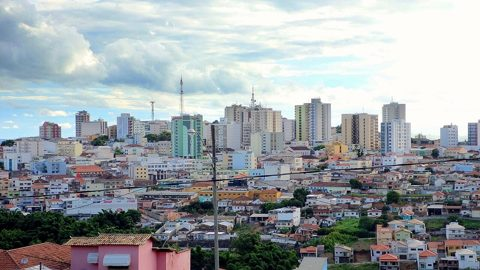

Recommended: Keep: it fits the story and the voice.

<!-- ask: single: Keep | Drop -->

### 8. Pathologist attributes infection to the being's claw
well-attested, Varginha, Brazil. object, free.

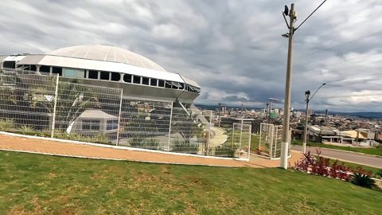

Recommended: Keep: it fits the story and the voice.

<!-- ask: single: Keep | Drop -->

### 9. Dr. Italo Venturelli meets live being in the ICU
well-attested, Hospital Regional, Varginha, Brazil. place-now, free.

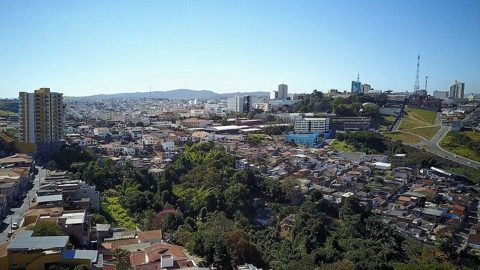

Recommended: Keep: it fits the story and the voice.

<!-- ask: single: Keep | Drop -->

### 10. Baltic Sea anomaly expedition
well-attested, Baltic Sea between Sweden and Finland. place-now, free.

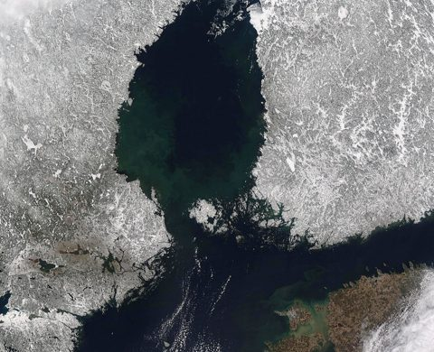

Recommended: Keep: it fits the story and the voice.

<!-- ask: single: Keep | Drop -->

### 11. Donald Menzel caught destroying plates, per Dorrit Hoffleit
well-attested, Harvard. person, free.

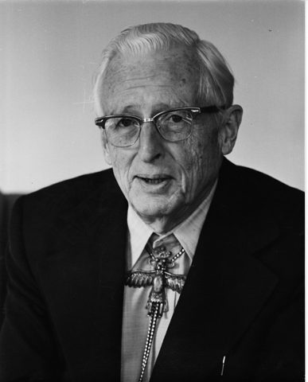

Recommended: Drop: the proposed rule in item 75: no face beside an accusation of the person shown, even with two tellers.

<!-- ask: single: Keep | Drop -->

### 12. Donald Menzel caught destroying plates, per Dorrit Hoffleit
well-attested, Harvard. place-then, free.

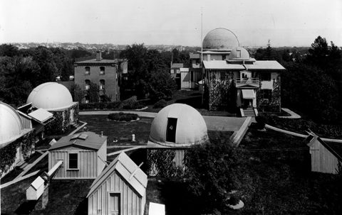

Recommended: Keep: it fits the story and the voice.

<!-- ask: single: Keep | Drop -->

### 13. AARO undercut by CIA and Air Force figures such as Kirkpatrick
well-attested, Washington, DC. person, free.

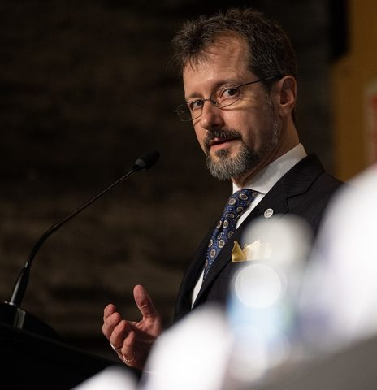

Recommended: Drop: a living official's face beside other people's claim that he undermined his office.

<!-- ask: single: Keep | Drop -->

### 14. AARO undercut by CIA and Air Force figures such as Kirkpatrick
well-attested, Washington, DC. place-now, free.

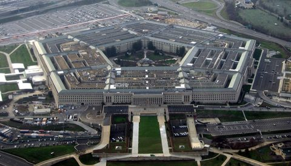

Recommended: Keep: it fits the story and the voice.

<!-- ask: single: Keep | Drop -->

### 15. Non-human biologics recovered with crashed craft
well-attested, United States (secret program). person, free.

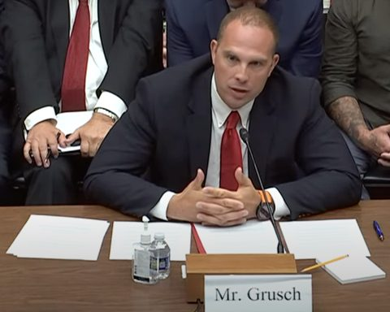

Recommended: Keep: it fits the story and the voice.

<!-- ask: single: Keep | Drop -->

### 16. At an LAX pedestrian death, all sound vanishes except the victim's breathing
well-attested, LAX, Los Angeles, California. place-then, free.

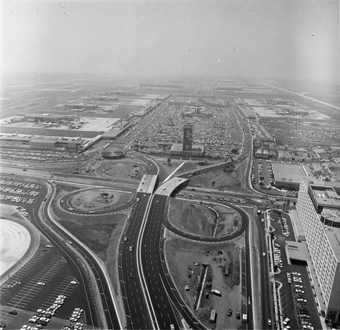

Recommended: Keep: it fits the story and the voice.

<!-- ask: single: Keep | Drop -->

### 17. Beings say they will not allow nuclear war
well-attested, Vandenberg Air Force Base, California. place-then, free.

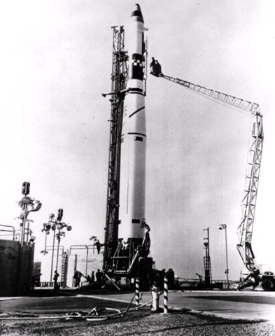

Recommended: Keep: it fits the story and the voice.

<!-- ask: single: Keep | Drop -->

### 18. Bismuth-magnesium sample said to be from Roswell, found in an army officer's grandfather's archives
well-attested, Roswell, New Mexico. object, free.

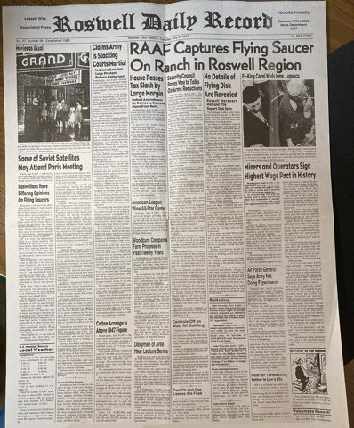

Recommended: Keep: it fits the story and the voice.

<!-- ask: single: Keep | Drop -->

### 19. Bismuth-magnesium sample said to be from Roswell, found in an army officer's grandfather's archives
well-attested, Roswell, New Mexico. place-then, free.

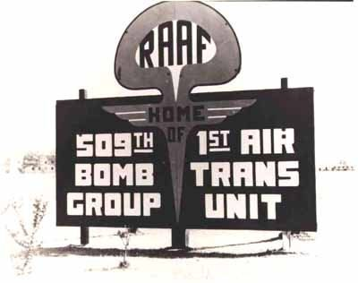

Recommended: Keep: it fits the story and the voice.

<!-- ask: single: Keep | Drop -->

### 20. Wall Street Journal op-ed and David Spergel's dismissal
told-once, USA. place-now, free.

Recommended: Keep: it fits the story and the voice.

<!-- ask: single: Keep | Drop -->

### 21. Noah Rodek's FOIA on Project Preserve Destiny forwarded to the NSA
told-once, United States. place-now, free.

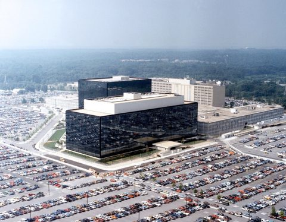

Recommended: Keep: it fits the story and the voice.

<!-- ask: single: Keep | Drop -->

### 22. Expired first patent and a new second patent (raised by Flint Dibble)
told-once, United States (USPTO). place-now, free.

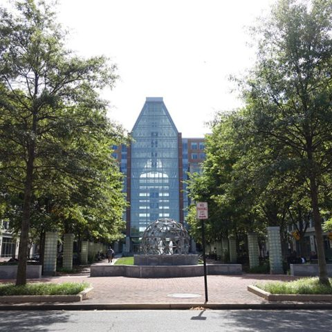

Recommended: Keep: it fits the story and the voice.

<!-- ask: single: Keep | Drop -->

### 23. Hall photon theory, copyrighted 1997 and inspired by faster-than-light craft
told-once, Nevada (based on Indian Springs sightings). place-now, free.

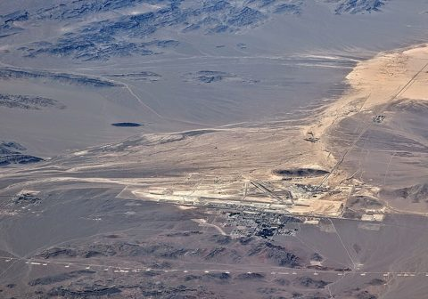

Recommended: Keep: it fits the story and the voice.

<!-- ask: single: Keep | Drop -->

### 24. FBI document calling Brown the Navy's lead radar scientist
told-once, United States Navy. object, free.

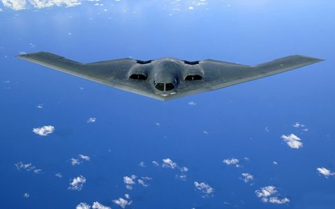

Recommended: Drop: the bomber is the host's aside, not the story's subject.

<!-- ask: single: Keep | Drop -->

### 25. FLIR, Gimbal and GoFast Navy videos
told-once, USA (Navy encounters). object, free.

Recommended: Keep: it fits the story and the voice.

<!-- ask: single: Keep | Drop -->

### 26. AARO's MFR marks Borland's triangle sighting unclassified and moves the rest into a SAP
told-once, AARO. object, free.

Recommended: Keep: it fits the story and the voice.

<!-- ask: single: Keep | Drop -->

### 27. Astra on the Skunk Works org chart
told-once, Skunk Works, Palmdale. place-then, free.

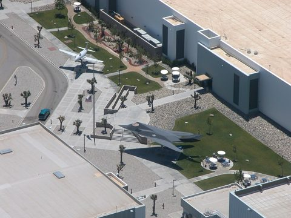

Recommended: Keep: it fits the story and the voice.

<!-- ask: single: Keep | Drop -->

### 28. Coming out after retirement: Daily Mail and Ty Roberts interviews
told-once, UK Daily Mail; International UFO Bureau (Oklahoma City). place-now, free.

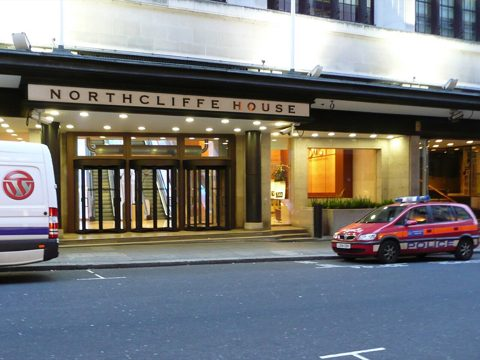

Recommended: Keep: it fits the story and the voice.

<!-- ask: single: Keep | Drop -->

### 29. Communion letters held in the Archives of the Impossible
told-once, Rice University, Houston, Texas. place-now, free.

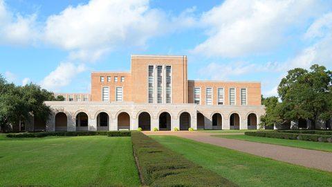

Recommended: Keep: it fits the story and the voice.

<!-- ask: single: Keep | Drop -->

### 30. Danny Sheehan shown Blue Book files and photo of crashed UFO with symbols
told-once, Washington, D.C. (SCIF). place-then, free.

Recommended: Keep: it fits the story and the voice.

<!-- ask: single: Keep | Drop -->

### 31. Ear sensation logged on blog before the Indian Ocean earthquake
told-once, blog; Japan; Indonesia. place-then, free.

Recommended: Drop: a disaster's devastation beside a claimed premonition of it.

<!-- ask: single: Keep | Drop -->

### 32. FOIA request for USAF Campinas flight records answered by the CIA
told-once, Campinas, Brazil / United States. place-then, free.

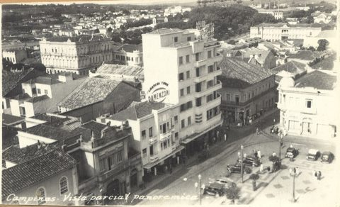

Recommended: Keep: it fits the story and the voice.

<!-- ask: single: Keep | Drop -->

### 33. Harrington's contact with David Grusch and his view of Grusch's testimony
told-once, Washington DC. place-now, free.

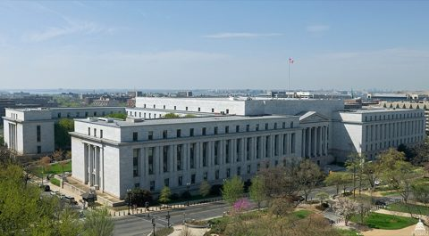

Recommended: Drop: the scout inferred the place from Grusch's hearing; the story itself names no building.

<!-- ask: single: Keep | Drop -->

### 34. Ingo Swann's reports to Scientology on the ONI remote viewing program
told-once, UK Guardian's Office; United States. place-now, free.

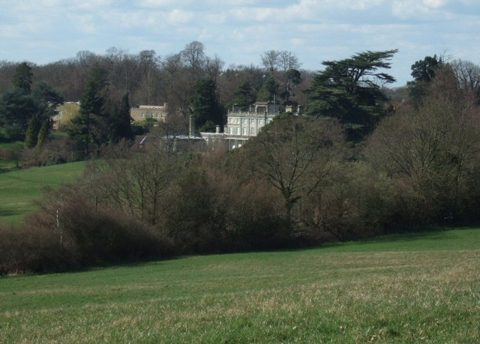

Recommended: Drop: the scout took the place from Wikipedia; the story names the Guardian's Office, not the manor.

<!-- ask: single: Keep | Drop -->

### 35. Jesus learned the resurrection technique in Egypt
told-once, Egypt. object, free.

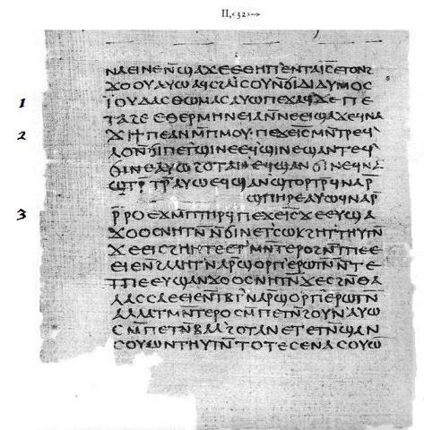

Recommended: Keep: it fits the story and the voice.

<!-- ask: single: Keep | Drop -->

## The person fold: decisions on 40 pairs

`check.py` lists 327 pairs of person ids within two letters of each other. An agent decided the first 40 from the person files and the tellings that name them: 33 are one person under two spellings, 7 are two people, none was unsure. Twelve of them are below: the five it was least sure of, the seven it called different, and three that show how spellings chain. Keep applies the decision as written, Edit takes your correction in the text field, Drop leaves both ids as they are.

### 51. allan-west / allen-west
1 and 1 stories. Allan West co-authored the 2007 Firestone Younger Dryas impact paper and Allen West is cited for the Comet Research Group Taurid danger; both are the Comet Research Group geologist Allen West.

Recommended: Keep: fold `allan-west` into `allen-west`, shown as Allen West.

<!-- ask: single: Keep | Edit | Drop -->
<!-- ask: "If Edit: the survivor id and name, or why they differ" text -->

### 52. beatric-val / beatric-vel
1 and 1 stories. Both are caption spellings of Beatriz Villarroel: Val is "Beatrice Valale at Stockholm University" in IWui5cBkwoE, Vel tells her July 1952 transients; both should end in beatriz-villarroel.

Recommended: Keep: fold `beatric-val` into `beatric-vel`, shown as Beatriz Villarroel.

<!-- ask: single: Keep | Edit | Drop -->
<!-- ask: "If Edit: the survivor id and name, or why they differ" text -->

### 53. ben-van-kerkwijk / ben-van-kirkwick
2 and 1 stories. Kirkwick is Joe Rogan citing the Great Pyramid power plant guest, the same UnchartedX researcher; the real spelling is Kerkwyk, so both should end in ben-van-kerkwyk.

Recommended: Keep: fold `ben-van-kirkwick` into `ben-van-kerkwijk`, shown as Ben van Kerkwyk.

<!-- ask: single: Keep | Edit | Drop -->
<!-- ask: "If Edit: the survivor id and name, or why they differ" text -->

### 54. armando-fortonado / armando-fortunato
2 and 3 stories. Both are the doctor in the Varginha case who did the autopsy on soldier Marco Chereze and spoke of the rare infection.

Recommended: Keep: fold `armando-fortonado` into `armando-fortunato`, shown as Armando Fortunato.

<!-- ask: single: Keep | Edit | Drop -->
<!-- ask: "If Edit: the survivor id and name, or why they differ" text -->

### 55. arthur-stansel / arthur-stansel-jr
2 and 1 stories. Both are the primary witness of the 1953 Kingman crash (the small being in the tent); the Jr. is a suffix, the plain id has more tellings.

Recommended: Keep: fold `arthur-stansel-jr` into `arthur-stansel`, shown as Arthur Stansel Jr..

<!-- ask: single: Keep | Edit | Drop -->
<!-- ask: "If Edit: the survivor id and name, or why they differ" text -->

### 56. andy-puharich / andre-puharich
1 and 1 stories. Andy Puharich is Andrija Puharich's son (captions 2-GeTxXi670 at 1:37:54: "Puharich's son Andy ... did this kind of like funny video"), not the father.

Recommended: Keep: different, both stay.

<!-- ask: single: Keep | Edit | Drop -->
<!-- ask: "If Edit: the survivor id and name, or why they differ" text -->

### 57. bill-seidman / bill-steinman
1 and 8 stories. Bill Seidman is cited by Harold Malmgren in the Ford-era NSA intelligence system story (the Ford economic adviser); Bill Steinman is the UFO researcher fired by Lockheed after his 1986 book.

Recommended: Keep: different, both stay.

<!-- ask: single: Keep | Edit | Drop -->
<!-- ask: "If Edit: the survivor id and name, or why they differ" text -->

### 58. carl-allen / paul-allen
1 and 1 stories. Carl Allen is the alias of Carlos Allende in the Philadelphia Experiment story (it should fold into carlos-allende); Paul Allen is the Microsoft co-founder backing SETI in the Buzz Aldrin story.

Recommended: Keep: different, both stay.

<!-- ask: single: Keep | Edit | Drop -->
<!-- ask: "If Edit: the survivor id and name, or why they differ" text -->

### 59. charles-hall / charles-halt
55 and 5 stories. Charles Hall is the Tall Whites firsthand teller at Nellis in 1965; Charles Halt is the Rendlesham Forest deputy base commander of the 1980 memo (no Hall story names Rendlesham).

Recommended: Keep: different, both stay.

<!-- ask: single: Keep | Edit | Drop -->
<!-- ask: "If Edit: the survivor id and name, or why they differ" text -->

### 60. chris-lee / chris-mel
1 and 1 stories. Chris Lee is the Skinwalker Ranch owner's best friend from fifth grade, a doctor; Chris Mel is Chris Mellon, the former deputy assistant secretary of defense for intelligence (should fold into a chris-mellon id).

Recommended: Keep: different, both stay.

<!-- ask: single: Keep | Edit | Drop -->
<!-- ask: "If Edit: the survivor id and name, or why they differ" text -->

### 61. agnew-bahnsen / agnew-bahnson
5 and 10 stories. Both are the North Carolina Institute of Field Physics founder who funded Townsend Brown and wrote The Stars Are Too High; Bahnson is the real spelling.

Recommended: Keep: fold `agnew-bahnsen` into `agnew-bahnson`, shown as Agnew Bahnson.

<!-- ask: single: Keep | Edit | Drop -->
<!-- ask: "If Edit: the survivor id and name, or why they differ" text -->

### 62. charles-buehler / charles-bueller
1 and 1 stories. Both are the NASA electrostatics scientist who measured thrust in a vacuum; the real spelling is Buhler, so both should end in charles-buhler.

Recommended: Keep: fold `charles-bueller` into `charles-buehler`, shown as Charles Buhler.

<!-- ask: single: Keep | Edit | Drop -->
<!-- ask: "If Edit: the survivor id and name, or why they differ" text -->

MISSING bobby-ray-inman

## Shapes to approve before the wide run

### 71. The fold is recorded in groups, not pairs
Spellings chain: Charles Buhler has five ids across four pairs, and in five pairs neither id is the right spelling (agnu-bonson and agnu-bonsson both belong under agnew-bahnson). The proposal: a new file `data/person-folds.json`, a list of groups, each `{ "canonical": id, "name": "Agnew Bahnson", "members": [ids], "reason": "..." }`, written from the deciders' answers and hand-correctable. A new stage `pipeline/people.py --fold` applies it: every member id in the stories (teller, teller_was, cites), the clips ledger (speaker, also_heard) and the image sidecars becomes the canonical id, the member files are deleted with their roles and links merged into the survivor, the member ids are kept in the survivor's `aliases`, and each member's name goes into `data/person-aliases.json` so the next merge maps the spelling at once. Then score, build, check. The fixture gets a chained case.

Recommended: Keep: one file holds the decision and its reason, the stage holds the mechanics, and the alias map keeps it from recurring.

<!-- ask: single: Keep | Edit | Drop -->
<!-- ask: "If Edit: what changes" text -->

### 72. The other 287 pairs are decided by three agents and applied without a second review
The pilot took one agent two minutes for 40 pairs, with reasons you can read above. The proposal: three Opus agents decide the rest in parallel, a "same" verdict with a reason that names the evidence is applied, "different" leaves both ids, and only the "unsure" ones (plus any where the survivor is a third id that does not exist yet) come to you in a short form before the fold runs.

Recommended: Keep: the pilot's reasons were sound, and 287 pairs in a form is a long afternoon.

<!-- ask: single: Keep | Edit | Drop -->
<!-- ask: "If Edit: what you want to see" text -->

### 73. The plain tellings move to a second file before the pictures land
`site/data.json` is 15.3 MB against the 16 MB an artifact allows a file, and pictures for six thousand stories add about 3 MB. The proposal: `build.py` writes `plain` into `site/plain.json` (and `plain.js` for the page opened from disk), the page fetches it after the first draw, and the story panel shows the plain telling once it has arrived. Nothing else about the page changes.

Recommended: Keep: it is the split the build already anticipates, and it keeps one artifact.

<!-- ask: single: Keep | Edit | Drop -->
<!-- ask: "If Edit: what changes" text -->

### 74. The wide picture run
The second pilot took about 6.5 minutes and 105k scout tokens per batch of 25 and found pictures for 16 of 25 stories in both the well-attested and the told-once batch. The whole backlog is 249 batches: 9 well-attested, 7 told-by-several, 233 told-once. At twelve scouts in parallel the two upper tiers take about a quarter of an hour; the told-once tier about 2.5 hours and 24 million scout tokens, for roughly 3,700 more stories with a picture. Each wave's manifests are ingested and committed as they come; you see nothing more until the end unless a wave's second read fails.

Recommended: All three tiers now: the usage is there and the shape is approved by this form.

<!-- ask: single: All three tiers now | The two upper tiers now, told-once later | The two upper tiers only -->

### 75. Four rules added to the scout brief from the second pilot
Each story's two searches are its own (one "Skywatcher" search counted for three stories until a follow-up). A told-once story's place must be named in the batch entry's own text, never inferred from a related article. No picture of a disaster, a death or a victim beside a claim. No person picture where the story accuses the person shown, whatever the teller count. The Varginha repetition (four stories, two town views) stays allowed: one file for several stories is the rule.

Recommended: Keep: each closes a case the second pilot produced.

<!-- ask: single: Keep | Edit | Drop -->
<!-- ask: "If Edit: what changes" text -->

